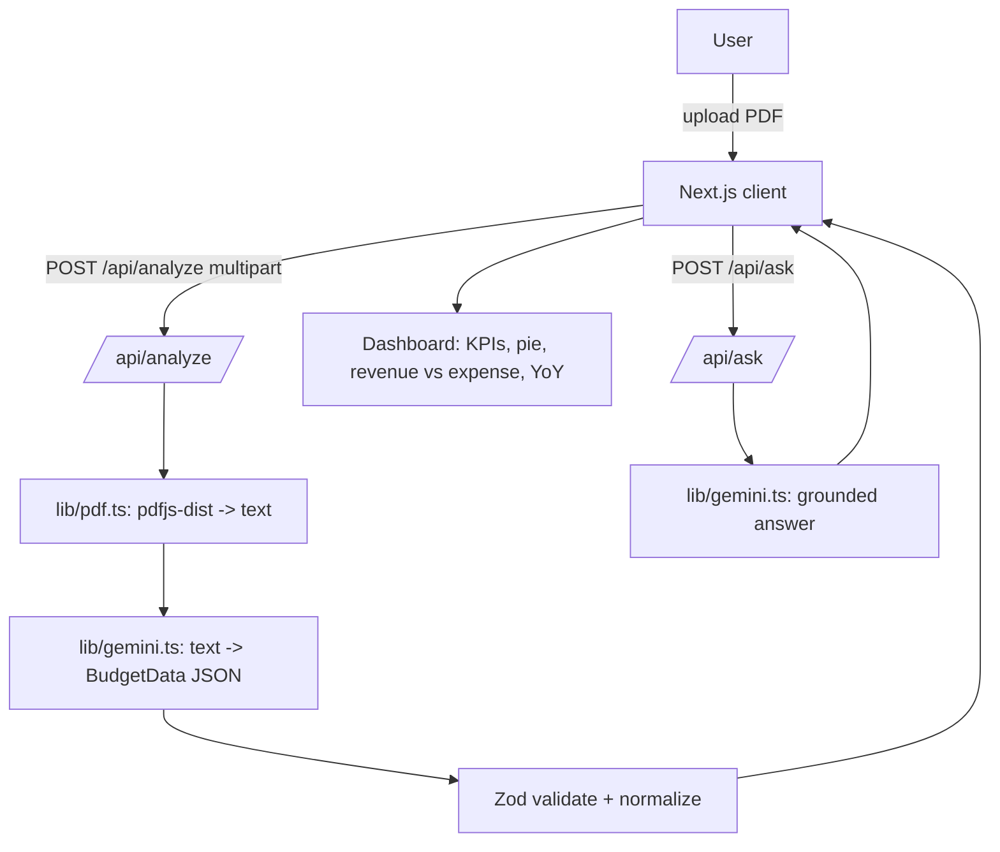

# Design — CivicClear Budget Explorer

## Overview
A single Next.js (App Router, TypeScript) app deployed to Vercel. Two API
routes do the server work; the client renders an upload screen that becomes a
dashboard once a budget is analyzed. No database — the analyzed budget lives in
client state for the session.

## Architecture



## Data model
Defined in `lib/budget-schema.ts` as the single source of truth.

```ts
LineItem        = { name: string; amount: number }
RevenueItem     = { source: string; amount: number }
YearTotal       = { year: string; total: number }

BudgetData = {
  title: string
  municipality: string
  fiscalYear: string
  totalBudget: number
  departments: LineItem[]
  categories: LineItem[]
  revenue: RevenueItem[]
  expenditures: LineItem[]
  yearOverYear?: YearTotal[]   // present only when multi-year data exists
  summary: string
}
```

A Zod schema mirrors this. A `normalizeBudget` step coerces currency strings to
numbers and drops rows with empty names or non-finite amounts before validation.

## API routes

### POST /api/analyze
- Runtime: Node (required by `pdfjs-dist`). `export const runtime = "nodejs"`.
- Input: multipart form-data with a `file` field (the PDF).
- Steps: read file → `extractPdfText` → `structureBudget` (Gemini) →
  `normalizeBudget` → Zod `parse` → return `{ budget, text }`.
- Errors: 400 for missing/invalid PDF or empty text; 502 for Gemini/validation
  failure. Always returns a JSON `{ error }` the UI can display.

### POST /api/ask
- Input: JSON `{ question, budget, text }`.
- Steps: build a grounded prompt (system instruction: answer only from context,
  admit when unknown) → Gemini → return `{ answer }`.
- Errors: 400 for missing question; 502 for model failure.

## Gemini integration (`lib/gemini.ts`)
- `getModel()` reads `GEMINI_API_KEY`; throws a clear error if unset.
- `structureBudget(text)`: calls the model with
  `responseMimeType: "application/json"` and a `responseSchema` matching
  `BudgetData`; returns parsed JSON (then normalized + Zod-validated by caller).
- `answerQuestion(question, context)`: plain text generation with a strict
  grounding system instruction.
- If the PDF text is very large, truncate to a safe character budget before
  sending; the compact structured JSON is always included for Q&A.

## UI components (`components/`)
- `UploadPanel` — drag-drop + file picker + loading + error display.
- `Dashboard` — composes the sections below from `BudgetData`.
- `KpiCards` — total budget, largest department, number of departments.
- `CategoryPie` — spending by category (falls back to departments).
- `RevenueVsExpense` — grouped/ío bar comparison of revenue vs. expenditure.
- `YearOverYear` — line/bar of yearly totals; renders only when data present.
- `ChatPanel` — question input, message history, loading state.

## Error & empty states
- Non-PDF / empty text → friendly inline error with retry.
- Scanned/image PDF (no text layer) → fall back to Gemini multimodal analysis.
- Gemini failure / rate limit → retry affordance.
- Missing `GEMINI_API_KEY` → explicit server error surfaced to the UI.

## Testing strategy
- `budget-schema`: schema accept/reject + currency normalization edge cases.
- `pdf`: extraction returns text on a fixture; graceful error on a bad buffer.
- `analyze` route: mock Gemini; assert schema-valid `BudgetData` returned.
- `ask` route: mock Gemini; assert context included, answer returned.
- Components: charts render with fixtures; YoY hidden when absent; upload shows
  loading; chat submit flow; error/empty states.

## Deployment
- Vercel project with `GEMINI_API_KEY` env var.
- `serverComponentsExternalPackages: ["pdfjs-dist"]` in `next.config.mjs`.
